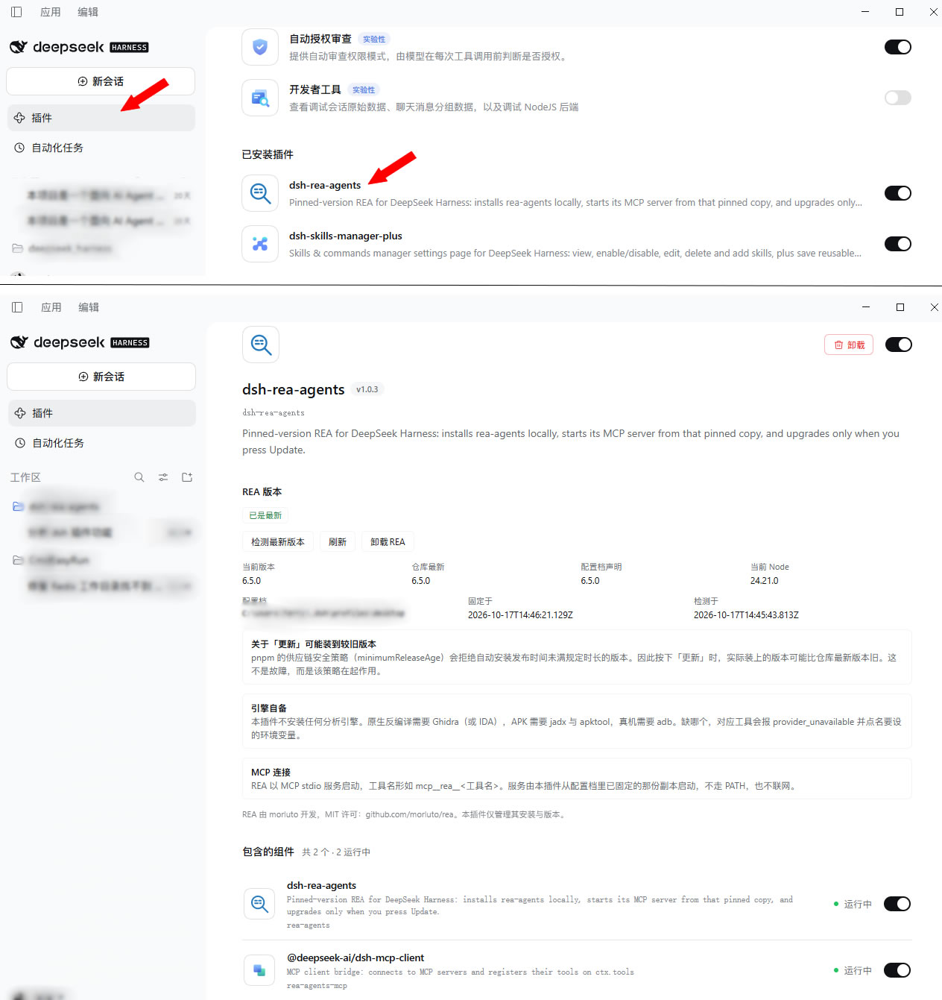
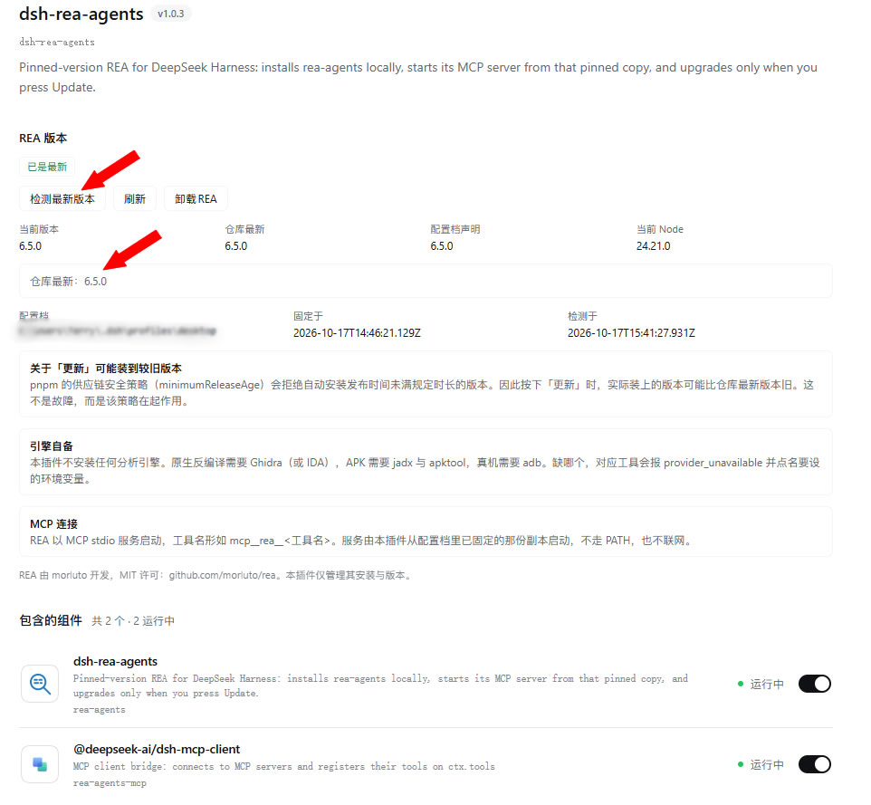
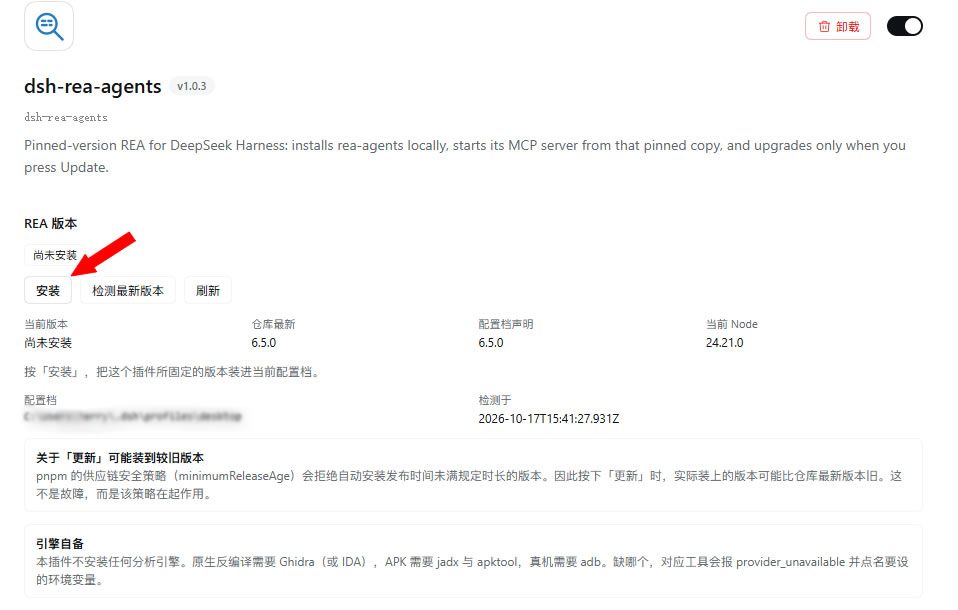

# dsh-rea-agents

[English](README.en.md) | 中文 | [更新日志](CHANGELOG.md)

把 [REA](https://github.com/morluto/rea)（`rea-agents`）**固定在一个确切版本**的 DeepSeek Harness 插件：
从配置档里那份副本启动它的 MCP 服务（207 个逆向分析工具），只有你在插件卡片上按下「更新」，版本才会前进。

为什么要固定版本，而不是沿用 `npx -y rea-agents@latest`？

- **跨会话结果无法对比。** 静默升级可能改变工具的参数结构、Evidence 处理方式或默认值，而你这侧没有任何记录说明它发生过。
- **被投毒的版本会立即生效。** 没有审查环节，也没有可回退的版本号。
- **「昨天还好好的」无法证伪。** 你分不清是目标变了，还是工具变了。

对一个专门产出「你要据此推理的证据」的工具来说，随时拉最新版是错误的默认值。本插件把它反过来：
启动时读磁盘上那份固定副本，新版本只在你看到版本号并主动点击之后才会到来。

## 截图

**插件 → dsh-rea-agents**：版本、安装状态与操作按钮，就长在插件自己的卡片上。



**检测最新版本**：走配置档自己的 registry（`pnpm view`），不另开网络通道。



**尚未安装**：按「安装」即把固定版本装进当前配置档。



## 安装说明

**版本要求：** DSH >= 0.1.6-alpha.1 且 < 0.3.0（`peerDependencies` 已按预发布分支显式声明）。
插件自身要求 Node >= 22.19.0；`rea-agents` 自己声明 `^22.19.0 || ^24.11.0 || >=26.0.0`，不匹配时页面会在安装前给出提示。

### 方式一：插件页安装（Desktop 用这个）

打开侧栏 **插件** → 右上角 **添加** → 填入来源后安装。

> **Desktop 的 profile 由 Electron 应用独占管理。** `dsh plugin --profile desktop …` 会被 CLI
> 直接拒绝（`error: profile "desktop" is managed exclusively by the Electron application`），
> 这是 DSH 的硬性约束，不是本插件的问题。Desktop 请在应用内安装。

### 方式二：命令行安装（web / tui 等 profile）

```sh
# npm 包（发布后可用）
dsh plugin --profile web add dsh-rea-agents

# GitHub 仓库
dsh plugin --profile web add github:<你的账号>/dsh-rea-agents

# 本地目录（以 link 方式安装，改动即时生效，适合开发调试）
dsh plugin --profile web add file:D:/path/to/dsh-rea-agents
```

装完重启 dsh（或等待 profile 热重载），在 **插件 → dsh-rea-agents** 的卡片上就能看到控件。

### 装上之后

插件只负责把 REA 装好、盯住版本、开好 MCP 连接。**安装 REA 本体需要在卡片上再点一次「安装」**，
它会写入依赖、执行 `pnpm add rea-agents@<版本> --save-exact`，并记录固定了什么。

### 验证

打开 dsh，进入 **插件 → dsh-rea-agents**，卡片上应出现「REA 版本」区块。没有出现时的排查顺序：

1. 确认装进了正在使用的 profile（`dsh plugin --profile web ls` 查看清单）；
2. 重启一次 dsh —— 浏览器半边的模块表在启动时构建；
3. 打开 `http://127.0.0.1:<你的端口>/rea-agents/diagnose`，按输出判断卡在哪一步（见下节）；
4. 仍无法解决时，附上 `/diagnose` 输出[提交 issue](../../issues/new)。

#### 确认 REA 真的接上了

卡片上有版本号，只说明插件在跑，**不说明 MCP 这条链路通了**。想确认工具真的可用，把下面这句交给 DSH 里的助手：

> 列出你的 `mcp__rea__` 工具，调用 `mcp__rea__binary_session`，参数为空 `{}`，看看返回什么。

助手能列出一批 `mcp__rea__` 开头的工具，并且 `binary_session` 返回一份会话信息
（而不是「没有这个工具」），就说明 REA 的工具已经注册到模型侧了。

### 更新与卸载

```sh
dsh plugin --profile web ls                     # 查看已装插件
dsh plugin --profile web add dsh-rea-agents      # 更新插件本身
dsh plugin --profile web remove dsh-rea-agents   # 卸载插件
```

卸载插件**不会**删除已装的 `rea-agents`；想一并清掉，先在卡片上点「卸载REA」，再移除插件。
分析引擎与本插件无关，任何时候都不会被删除。

## 界面在哪

控件位于 **插件 → dsh-rea-agents → 卡片上，描述与「包含的组件」之间**，与那个插件的总开关、
卸载按钮在同一张卡片上。REA 是一个插件，它的版本是插件的属性，不该和「账号与余额」「模型」
这类顶层偏好并列。

插件总开关是**总闸**：关掉会同时移除 MCP 服务与这张卡片上的区块，打开则一起回来，改开关无需重启。

## 功能

| 能力 | 说明 |
| --- | --- |
| 安装 | 把 registry 当前提供的版本**精确**装进配置档并固定，写入 `--save-exact` |
| 检测最新版本 | 用配置档自己的 registry 查询（`pnpm view`），沿用你的 registry / 代理 / 认证设置 |
| 更新 | 原地迁移到该版本（一次 `pnpm add`，不是先卸载再装） |
| 卸载REA | 移除固定副本。REA 工具停用，直到重新安装 |
| 刷新 | 重新读取磁盘状态 |
| 版本对照 | 当前版本 / 仓库最新 / 配置档声明 / 当前 Node，四者并列展示 |
| 多语言 | 区块右上角可手动选择**跟随界面 / 中文 / English**，选择记在浏览器里；默认跟随界面语言 |
| 操作后刷新 | 任何操作结束后都从磁盘回读一次状态，不必手动点刷新 |

页面上的版本**每次都从磁盘回读**，所以你看到的就是 MCP 服务将要启动的那一份。

语言控件是**按区块**生效的，不影响 DSH 本身的语言设置：你可能习惯中文界面，
但要拿英文截图给别人看，反之亦然。选「跟随界面」就回到默认行为。

## 关于「更新」可能装到较旧版本

pnpm 的供应链安全策略（`minimumReleaseAge`）会拒绝自动安装发布时间未满规定时长的版本 ——
因为它面世还不够久，没人来得及发现它是否有恶意。这条策略对本插件的安装同样生效。

所以按下「更新」，有可能在仓库最新是 `6.6.0` 时**实际装上 `6.5.0`**。本插件会明说这件事：
**按之前**就把原因写在卡片上，**按下之后**如果真发生，再报一次：

> 本次安装的是 6.5.0，而不是 6.6.0。按 pnpm 供应链安全策略（minimumReleaseAge），
> 6.6.0 发布时间未满规定时长，未通过观察期，因此未被安装。

这不是需要绕过的故障。绕过观察期的插件，等于拿「固定版本」本应提供的保障，
去换一个「看起来是最新的」的外观。

### 无关的包不该拖住 REA

pnpm 在改动前会**校验整个 lockfile**。所以只要配置档里**任何一个**条目还没度过观察期，
**所有** pnpm 操作都会被拒绝 —— 哪怕那个包与 REA 毫无关系（现场就是这么卡住的：
`dshmarket` 的一个新版本拖住了 REA 的更新）。本插件的处理：

1. 从 pnpm 的报错里解析出**真正违规的条目**；
2. 只对它们加 `--config.minimum-release-age-exclude` 重试一次；
3. 更新成功后，在页面上说明本次豁免了哪些条目。

**但绝不豁免 REA 自己。** 如果你要的 REA 版本太新，更新会保持失败并说明原因 ——
豁免它等于悄悄取消你在意的观察期，这一点是刻意的。

被豁免的条目**本身不会被改动**，它们只是不再阻塞本次操作。

## 引擎自备

本插件**不安装任何分析引擎**，与 REA 本身一致。REA 只是适配层；缺哪个引擎，
只有对应工具报 `provider_unavailable`，并在提示里点名该设哪个变量。

| 用途 | 需要自备 |
| --- | --- |
| 原生 PE/ELF 静态分析 | [Ghidra](https://github.com/NationalSecurityAgency/ghidra) 12.1.x + JDK 21+，或自备 IDA |
| APK 资源 / DEX | apktool、jadx |
| 真机 / 模拟器 | Android platform-tools（adb） |
| 抓包 / 信号 / 固件 / WASM / SQLite | tshark、sigrok-cli、binwalk 或 unblob、WABT、Node 内置 SQLite |

请设成**用户或系统环境变量**再启动 DSH —— MCP 服务继承 harness 进程的环境：

```powershell
GHIDRA_INSTALL_DIR     = D:\tools\ghidra_12.1.4_PUBLIC
JAVA_HOME              = D:\tools\jdk-21
REA_JADX_MCP_JAR       = D:\tools\jadx-headless-mcp-0.7.1-all.jar
REA_APKTOOL_COMMAND    = D:\tools\apktool\apktool.cmd
REA_ADB_PATH           = D:\Android\Sdk\platform-tools\adb.exe
REA_TSHARK_COMMAND     = D:\tools\Wireshark\tshark.exe
REA_CAPINFOS_COMMAND   = D:\tools\Wireshark\capinfos.exe
REA_SIGROK_COMMAND     = D:\tools\sigrok\sigrok-cli.exe
REA_WABT_BIN_DIRECTORY = D:\tools\wabt\bin
```

> MCP 子进程的环境经过了**清洗**（凭据形状与过期的 `DSH_*` 变量会被移除）。
> 上面这些变量不属于被清洗的范围，可以正常继承。pnpm 不在 PATH 上时，可用
> `DSH_PNPM_PATH` 指向 pnpm 可执行文件。

## 固定了什么、写在哪里

本插件只写两处，且都在当前配置档内：

```
<profile>/package.json                  # dependencies 里精确声明 rea-agents@<版本>
<profile>/dsh-rea-agents/pin.json       # 固定记录：版本、时间、来源、被扣留的构建
```

它**从不读写你的补丁层** `cordis.patch.yml`。两个 loader 条目由本插件的 bundle patch 提供：

| 条目 id | 作用 |
| --- | --- |
| `rea-agents` | 本插件的宿主半边（固定与安装 REA） |
| `rea-agents-mcp` | MCP 服务，从配置档内那份固定副本启动 |

MCP 条目的 `command` 是**正在运行 harness 的那个运行时**，而非 PATH 上的 `node`；
启动器路径由 harness home 计算而来。两者都必要：MCP 子进程的环境经过清洗，
路径必须在宿主侧求值，不能从子进程里现找。启动器**不查 PATH**、
**不联网**，因此一次启动不可能拉取或执行新发布的版本。

> **条目 id 为什么是 `rea-agents-mcp` 而不是更短的 `rea-mcp`？**
> 如果你的 profile 曾手工登记过 REA，它可能留下 `- id: rea-mcp` / `disabled: true` 覆盖行。
> 沿用短 id 的话，那行会**静默关掉本插件的 MCP 服务，而卡片页面照常工作** ——
> 一种「看起来是成功」的失败。使用独立 id 后两者互不干扰，旧条目自然失效。

## 安全约定

- **只响应本机请求。** API 挂在同一个 loopback web server 上，非 loopback 来源直接 403。
- **只装一个包。** 除了 `rea-agents`，不向配置档添加任何依赖。
- **不装引擎。** Ghidra、IDA、jadx、apktool、adb 等始终由你自行准备。
- **不改你的补丁层。** 固定记录写在本插件自己的状态目录里，`cordis.patch.yml` 从不被读写。
- **不绕过供应链策略。** 观察期拦下的版本如实报告，不私自改用其它安装通道。

## 排查

### `/rea-agents/diagnose`

回答一个离线无法回答的问题：**浏览器半边有没有进到页面的模块图里**。

```sh
curl http://127.0.0.1:<端口>/rea-agents/diagnose
```

- `graph.selfPresent` 为 `true` —— bundle 已被页面接受；为 `false` 则问题在包发现环节
  （`package.json` 的 `dsh.client`、`exports["./client"]`、能否解析到该包）。
- `gates` 报告 composer 的逐行门禁：没有 fiber、或拿不到解析基准 URL 的行永远到不了页面，
  即使它出现在 Loader 里。
- `selfRows` 同时报告 `rea-agents` 与 `rea-agents-mcp` 两行 ——
  后者的模块名 `@deepseek-ai/dsh-mcp-client` 不含 `rea`，所以这里按 id 匹配。

### `frida` 的构建脚本被扣留

安装 REA 时 pnpm 会对可选的 `frida` 报 `ERR_PNPM_IGNORED_BUILDS`。
**包已经装好、CLI 也能启动**，只有需要已编译 Frida 绑定的运行时插桩类工具不可用。

本插件**以磁盘结果为准**判断安装是否成功，并把被扣留的构建作为一条较温和的事实报出来。
只看退出码会把你那份可用的副本误报成「安装失败」。

### 工具报 `provider_unavailable`

说明该工具所需的引擎缺失。读该操作的 provider 诊断，或调用 `binary_session` 查看
`result.tool_availability`，它会点名该设哪个环境变量。装齐后需要**重启 DSH**
（环境变量只在启动时读取）。

## 开发

```sh
npm test                # 主套件（宿主半边 + 浏览器半边）
npm run test:render     # 浏览器半边在 loading / ready / failed 三种状态下的渲染
npm run test:dict       # 中英双语字典审计
npm run test:docs       # 文档自检：交叉链接、截图清单与实际引用是否一致
npm run test:discovery  # 客户端模块发现（dsh.client / exports["./client"]）
npm run test:compose    # 真实 profile 的解析路径
```

| 套件 | 覆盖范围 |
| --- | --- |
| `test/run.mjs` | 宿主端全部 HTTP 路由；用假的 Cordis 上下文驱动真实 `apply()`；非 loopback 拒绝；版本串校验；MCP 启动器的缺失补救 |
| `test/render.mjs` | 用最小 React 真实驱动浏览器半边，断言 loading / ready / failed 三种状态都有内容；并静态检查每个被渲染的组件都有定义 |
| `test/dictionary.mjs` | 中英字典：键是否双语齐备、是否都被读取、有没有读了却没定义 |
| `test/docs.mjs` | 中英文档互链是否指向存在的文件；`screenshots.json` 与实际嵌入的图片是否双向一致 |
| `test/discovery.mjs` | 按 composer 的步骤逐条验证包发现 |
| `test/compose-check.mjs` | 用真实 profile 复现 composer 的判定 |

测试不依赖任何测试框架，只用 Node 内置能力。

### 结构

```
lib/index.js      宿主半边：固定版本、跑 pnpm、发布 loopback API
lib/client.js     浏览器半边：插件卡片上的配置区块（lazy-CJS，无构建步骤）
lib/rea-mcp.mjs   MCP 启动器：从配置档解析固定副本，不走 PATH、不联网
cordis.patch.yml  bundle patch：插入上面两条 loader 条目
```

## License

本插件自身代码 MIT，见 [LICENSE](./LICENSE)。

REA 由 [morluto](https://github.com/morluto/rea) 开发，MIT 许可。
本插件**不含任何 REA 源码、也不含第三方二进制** —— 它在你的请求下从 registry 下载该包。
它同样不附带 REA 的文档与技能：那些属于安装它们的那个东西。
